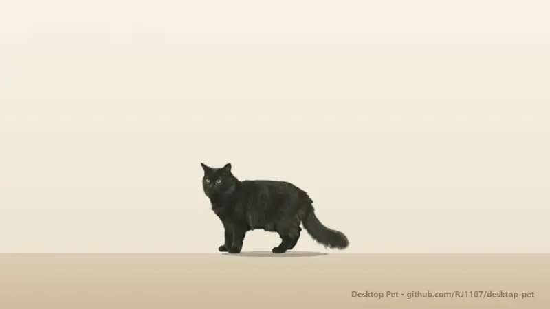

# 桌面宠物（Desktop Pet）



[完整视频（MP4，70 秒）](docs/demo.mp4)

一只住在你电脑桌面上的猫或狗，样子照着你家宠物的照片生成，动作是 AI 拍出来的真实影像。它会自己走、跑、坐、睡、揣手手、伸懒腰、扒墙、洗脸、打哈欠、翻肚皮；你可以喂它猫粮、猫条和水，它会用额头蹭你的手；可以打字或说话和它聊天，它有自己的性格，也会记住你告诉它的事。上面视频里是作者家的黑猫 Gigi。

*English: a cat or dog that lives on your desktop. Give it one to three photos of your own pet; an image model paints it and a video model films 18 motions, which the app cuts out of their green screen and plays on top of your desktop. Chat by text or voice through any OpenAI-compatible service. Windows and macOS. You bring your own API key; a full set of motions costs about US$2.2.*

## 拿到项目后怎么用

### 1. 准备

- **Node.js 22 或更高版本**：到 [nodejs.org](https://nodejs.org) 下载安装。这是运行这个项目的基础环境。
- **一个 API 密钥**：程序靠它调用网上的 AI 模型，费用从你自己的账户扣。默认用 [OpenRouter](https://openrouter.ai)，一个账户就能调用很多家的模型。注册后充值几美元（做一只宠物约 2–3 美元），在 Keys 页面生成一个密钥。也可以用其他兼容 OpenAI 格式的服务。

### 2. 下载和安装

```bash
git clone https://github.com/RJ1107/desktop-pet.git
```

```bash
cd desktop-pet
```

```bash
npm install
```

`npm install` 会下载 Electron（把网页做成桌面程序的工具），大约 100 MB。

### 3. 启动

```bash
npm start
```

想以后双击就能打开，运行一次：

```bash
node scripts/make-shortcut.mjs
```

- **Windows**：桌面上多一个带爪印图标的"桌面宠物"。
- **macOS**：桌面上多一个"桌面宠物.command"。第一次双击时，如果系统提示无法打开，在它上面点右键 →"打开"即可；之后直接双击。

第一次启动时，桌面上先出现一只卡通替身，同时打开设置窗口。程序图标在系统托盘（Windows 右下角 / macOS 屏幕顶部菜单栏）。

### 4. 填你的密钥

设置窗口 →"对话与语音"→"连接"：粘贴密钥，点"保存设置"，再点"测试：打个招呼"，看到回复就通了。密钥用操作系统的加密功能保存在你自己的电脑上（Windows 的 DPAPI，macOS 的钥匙串），不会出现在任何文件里明文显示。

### 5. 做你家的宠物（"形象"页的三步）

1. **它是谁**（不花钱）：名字、猫还是狗、品种（猫 26 种、狗 17 种）、性别、体重、毛色和眼睛颜色。体重决定它在桌面上的大小。
2. **照片和它的特点**（不花钱；识别每次不到 1 美分）：选 1 到 3 张清晰的照片，侧面全身最好，再打字或口述它的特点，比如"耳尖有长毛""左前爪是白的"。可以点"让视觉模型从照片识别品种和颜色"自动填好第 1 步。
3. **生成写实形象**（花钱的只有这一步）：
   - **画形象照**（约 0.05 美元，约 1 分钟）：画出一张你家宠物站在绿幕前的写实侧身照，不满意可以换一张。
   - **拍摄动作**（18 个约 2.2 美元，几分钟）：按钮上写着还缺几个、大约多少钱。拍完程序自动抠图，桌面上的替身随即换成你家宠物。
   - 哪个动作拍得不好，点它的小标签、再点一次确认，就能单独重拍（每段约 0.12 美元）。

想养好几只："形象"页最上面"我的宠物"→"+ 添加一只"。每只有自己的形象、动作、照片、碗、记忆和聊天记录。

### 6. 怎么和它玩

| 操作 | 效果 |
| --- | --- |
| 鼠标停在它身上 | 鼠标变成一只小手，显示名字和四项状态（饱腹、饮水、精力、心情） |
| 手在它头旁边待两秒多 | 它转过来用额头蹭你的手 |
| 在它身上来回蹭鼠标 | 抚摸；连着摸三下，它翻过来露肚皮 |
| 单击 | 它坐着或睡着时把它叫起来，其他时候打开菜单 |
| 右键 | 菜单：猫粮、猫条、喝水、聊天、睡觉；下面一行是设置、隐藏、退出 |
| 按住拖动 | 把它拎起来，松手掉回地面 |
| 双击 | 聊天。聊天框右端的 ✕ 或 Esc 关闭 |
| 托盘图标 | 左键聊天，右键菜单 |

它不在的地方，鼠标点击直接穿透到下面的窗口，不影响你正常用电脑。屏幕两侧是实心的墙，它的鼻尖和尾巴不会伸出屏幕。

## 它是怎么做出来的：用了哪些模型

| 步骤 | 做什么 | 默认模型 | 在哪里算 | 大约花费 |
| --- | --- | --- | --- | --- |
| 识别照片（可选） | 看照片，填品种、体重、颜色 | Gemini 3.8 Flash | 云端 | 每次不到 1 美分 |
| 画形象照 | 照片 + 品种、体重、颜色 + 你的描述 → 一张绿幕前的写实侧身照 | Nano Banana 2.1（Google 的图像模型） | 云端 | 约 $0.05 |
| 拍动作 | 形象照作为第一帧和最后一帧 + 一段动作描述 → 4 秒视频，每个动作一段 | Veo 3.1 Lite（Google 的视频模型） | 云端 | 每段约 $0.12 |
| 抠图和测量 | 去掉绿幕，量出循环点、嘴的位置、身体宽度 | 不用模型，程序自己算 | 你的电脑 | 免费 |
| 聊天 | 按它的性格、状态和记忆回话 | Claude Haiku 5.5 | 云端 | 每句不到 1 美分 |
| 语音输入 | 把你说的话写成文字 | Gemini 3.8 Flash | 云端 | 每次不到 1 美分 |
| 朗读回复 | 默认用电脑自带的声音；也可换成语音服务 | 系统语音 / ElevenLabs（可选） | 本机 / 云端 | 免费 / 按量 |

几个要点：

- **视频不是直接从照片拍的。** 先由图像模型画出一张统一的形象照：同一只动物、站在纯绿背景前、正侧面。再拿这张图分别拍每个动作，所以 18 段视频里是同一只猫，大小和站位也一致。
- **每段视频首尾都是这张形象照**，所以任何两段之间都能无缝衔接，不会有跳变。这个思路参考了开源项目 dsh-pet。
- **抠图**的意思是把绿色背景去掉，只留下动物本身，变成透明背景的图片，就像电影里的绿幕特效。程序按每个像素"绿得有多明显"来定透明度，所以毛发边缘是柔和的；只去掉和画面边缘相连的绿色，所以绿色的眼睛不会被抠掉；视频模型自己画在地上的碎屑也会被清掉。
- 抠图之后，程序还会**量**出：走路时哪两帧最像，可以首尾相接循环；吃东西时嘴在哪里，好让嘴正对碗；身体有多宽，好让它不穿墙；揣手手时哪一帧最安静、眼睛睁得最开，就定格在那一帧。
- 所有模型都可以在"对话与语音"→"高级：更换模型"里换成别的，价格随之变化。

## macOS

代码同时支持 Windows 和 macOS，用的是同一套程序（Electron）：透明置顶的宠物窗口、鼠标穿透、菜单栏图标、钥匙串保存密钥、麦克风授权都按 macOS 的方式处理。

**作者只在 Windows 11 上实际用过。** 仓库的自动检查（GitHub Actions）会在每次提交时，在 macOS 和 Windows 上各跑一遍全部测试，包括真正启动应用的那一套。Mac 上的真实使用体验，比如多个桌面空间、全屏应用之上的显示，还没有人看过。遇到问题欢迎提 issue。

## 数据存在哪

- 宠物、照片、动作视频都只存在你自己的电脑上：
  - Windows：`%APPDATA%\desktop-pet`
  - macOS：`~/Library/Application Support/desktop-pet`
- 只有生成形象、聊天、语音输入时，照片和文字会发给你自己账户下的模型服务。
- 每天第一次保存前，程序会自动备份一份宠物数据到上面文件夹里的 `backups/`，保留最近 14 天。

## 更多细节

**它自己会做的事**（按概率来，不是每次都做）：
- 睡醒后：有时原地伸懒腰、有时走到屏幕边扒墙、有时洗脸。
- 走到或被你拎到屏幕边时：有时扒墙。
- 坐一阵后：常洗个脸。
- 闲着时：偶尔打哈欠、轻声喵、翻肚皮、对空中扑两下。
- 很饿时张大嘴喵喵叫，很困时先打个哈欠再睡。
- 它不会自己突然跳，只在你让它跳时才跳。

**吃东西**：你放下食物它就会过来，睡着也会先起来。猫粮是碗里一粒一粒的，吃一口少三粒；水面会随着喝下降。关掉程序期间它会变饿，但不会饿死。可以在"形象"页最下面用照片换成你家自己的猫粮碗和水碗（每个约 0.05 美元）。

**动作怎么播放**：
- 站立正放再倒放。
- 坐和睡：入座后停在最安静的半秒，只剩呼吸。
- 走和跑：找出最像的两帧循环，按距离规划成"起步 → 整数次循环 → 停下"，到达时脚步正好停住。
- 伸懒腰、翻肚皮：变速播放，慢的地方前后两帧叠化过渡。
- 转身时画面渐变，不会瞬间翻转。

**对话**：
- 性格是一个 Markdown 文件，内置猫和狗各一份（`personalities/`），可以换成你自己写的。
- 聊天时它会记下值得记的事，"记忆"页可以查看和删除。
- 它能听懂"跳一下""过来""伸个懒腰""翻个肚皮""蹭蹭我"这类话并真的去做。
- 改名：直接改名字，或者告诉它"以后你叫 XX"。

## 开发

```
src/main/        主进程：窗口、托盘、存储、模型调用、形象生成、碗
src/renderer/    宠物窗口和设置窗口
src/renderer/pet 行为（brain.js）、播放影像（real.js）、生成前的替身（rig.js）
src/shared/      纯逻辑：状态、品种、抠图、播放规则、记忆、提示词
personalities/   内置性格
scripts/         桌面快捷方式、开发看板
test/            测试和工具
docs/            演示视频
```

```bash
npm test
```

40 组逻辑测试，不需要启动界面。

```bash
npm run check
```

真正启动应用，走完 18 步：从领养、照片、密钥、喂食、拖拽、聊天、语音，到生成写实形象、碗、多只宠物、改名、重启后数据还在。模型由本地替身服务扮演，不需要密钥也不花钱。

`test/` 里还有几个工具：
- `record-demo.cjs` 录上面那段演示视频；
- `ui-shots.cjs` 给每个界面截图；
- `real-cut.cjs` 用已下载的视频重新抠图。

这三个都不花钱，而且都在数据的副本上运行。`real-probe.cjs`、`real-bowl.cjs`、`real-chat.cjs` 会调用真实模型、会花钱，必须带 `--spend` 才运行。

开发过程记录在一个本机网页看板上（`scripts/open-board.mjs`，看板工具本身见 [ai-coding-kanban](https://github.com/RJ1107/ai-coding-kanban)）。

## 已知的不足

- 视频模型不总能拍对复杂动作：
  - 扒墙时身体约 60 度斜靠，不是贴墙站直；
  - 纯侧面看，并排伸直的两条前腿会叠成一条；
  - 揣手手常常拍成坐起来，或者前爪没揣进去。

  拍得不满意的可以单独重拍。
- 连续动起来的观感只有作者自己看过；macOS 的真实使用、狗、多显示器还没有人试过。
- 用照片生成碗的功能只用本地替身模型测过。
- 内存占用偏大：静置约 700 MB。
- 还没有打包成安装程序，目前用 `npm start` 或桌面快捷方式运行。

## 许可证

[MIT](LICENSE)
